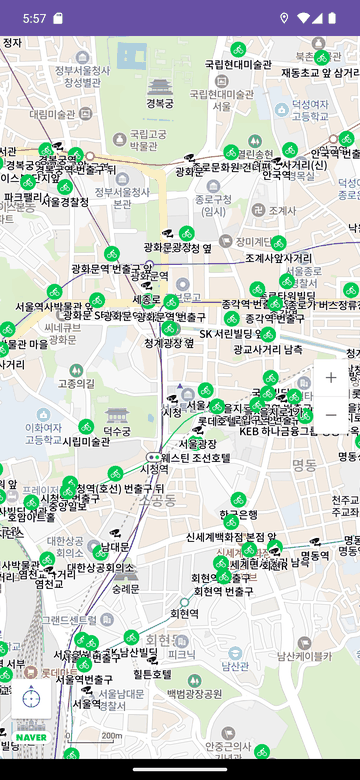
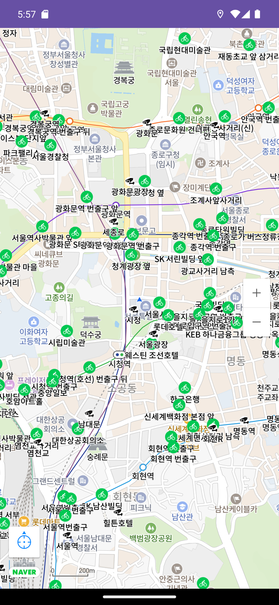
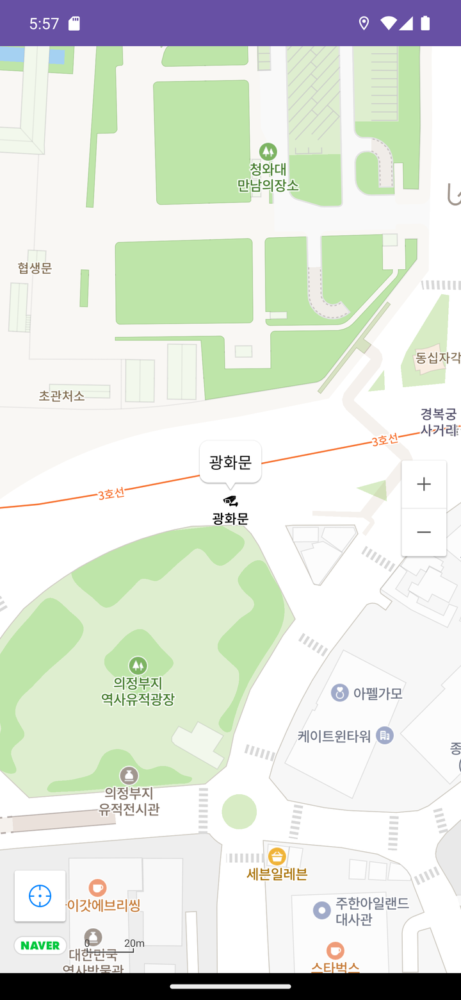
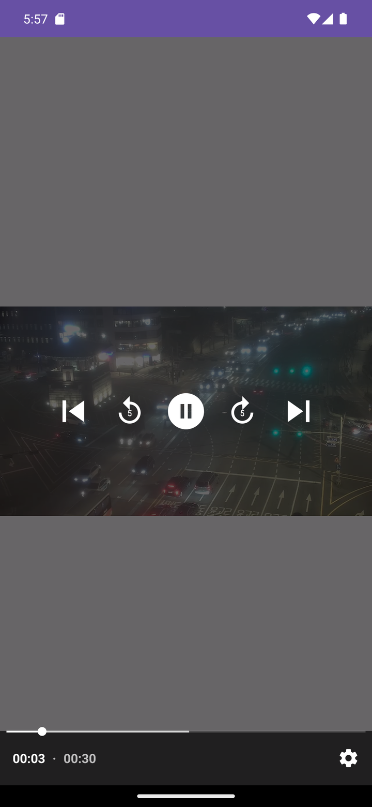
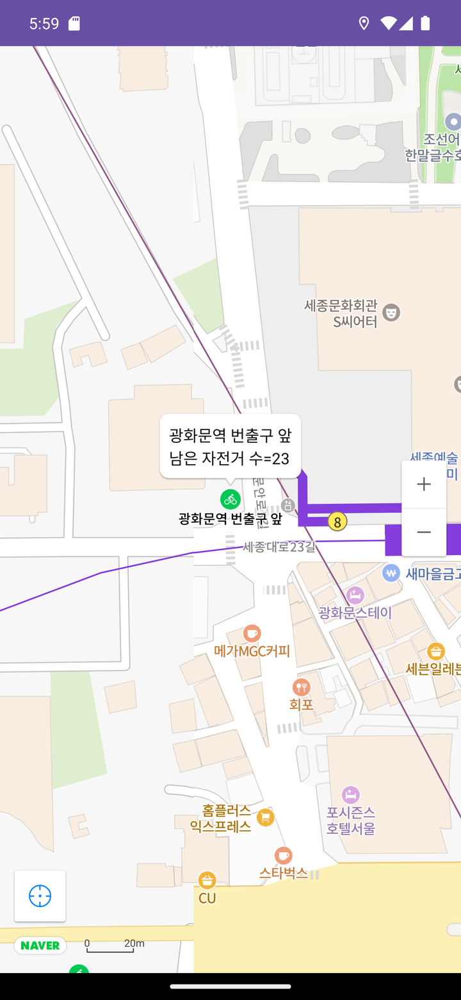

# NaverMapToAPI

네이버 지도 위에 **전국 CCTV 위치**와 **서울 따릉이 대여소**를 마커로 표시하고, CCTV 마커를 선택하면 **실시간 CCTV 영상을 재생**하는 Android 앱입니다.
공공데이터 API와 로컬 엑셀 데이터를 조합해 약 1만 4천 개의 마커를 지도에 보여줍니다.

**목차:** [시연](#시연) · [주요 기능](#주요-기능) · [데이터 소스](#데이터-소스) · [기술 스택](#기술-스택) · [프로젝트 구조](#프로젝트-구조) · [실행 방법](#실행-방법) · [참고 사항](#참고-사항)

## 시연

<p align="center">
  
</p>

> 지도에서 CCTV 마커를 누르면 지도가 확대되며 정보창이 열리고, 정보창을 누르면 CCTV 영상이 재생됩니다.
> (Android 에뮬레이터 Pixel 7 Pro, API 33에서 촬영)

## 주요 기능

### 1. 지도에 CCTV·따릉이 위치 표시

네이버 지도 위에 **CCTV(카메라 아이콘)** 와 **서울 따릉이 대여소(초록색 자전거 아이콘)** 를 함께 표시합니다. 현위치 버튼과 줌 컨트롤도 지원합니다.

<p align="center">
  
</p>

### 2. 마커 선택 → CCTV 정보창

CCTV 마커를 누르면 해당 위치로 지도가 확대되고, CCTV 이름이 담긴 정보창이 열립니다.

<p align="center">
  
</p>

### 3. 정보창 선택 → CCTV 영상 재생

정보창을 누르면 `VideoActivity`로 이동해 ExoPlayer로 CCTV 영상을 스트리밍(HLS 등)합니다. 뒤로가기로 지도로 돌아옵니다.

<p align="center">
  
</p>

> 영상은 서버 응답 후 재생되기까지 몇 초에서 십수 초가 걸릴 수 있습니다.

### 4. 따릉이 대여소 정보 (서울)

따릉이 대여소 마커를 누르면 **대여소 이름과 남은 자전거 수**를 보여줍니다.

<p align="center">
  
</p>

### 그 밖의 기능

- **위치 권한 처리** – 실행 시 위치 권한을 요청하고, 거부 시 안내 다이얼로그 표시
- **다양한 데이터 소스** – ITS·제주·서울 공공 API와 엑셀 데이터를 한 지도에 통합 ([데이터 소스](#데이터-소스) 참고)

## 데이터 소스

| 구분 | 출처 | 코드 |
|------|------|------|
| 고속도로/국도 CCTV | 국가교통정보센터(ITS) `cctvInfo` API | `ItsCCTVService`, `getItsResponse()` |
| 제주 CCTV | 제주 공공데이터 `getSnowfallCctvList` API | `JeJuCCTVService`, `getJeJuCCTVResponse()` |
| 서울 따릉이(공공자전거) 대여소 | 서울 열린데이터광장 `bikeList` API (대여소 위치·남은 자전거 수) | `SeoulAPIService`, `getResponse()` |
| 지자체 오픈데이터 CCTV | `assets/OpenDataCCTV.xlsx` (Apache POI로 백그라운드 파싱) | `loadExcelCctvAsync()`, `parseExcel()` |
| 대전 CCTV | 코드 내 하드코딩된 좌표/영상 URL | `getDaejeonCCTVData()` |

## 기술 스택

- **언어**: Kotlin `1.8.0`
- **빌드**: Android Gradle Plugin `8.1.0`, Gradle `8.0`
- **SDK**: minSdk 26 / targetSdk·compileSdk 33
- **지도**: Naver Maps SDK `3.17.0`
- **네트워크**: Retrofit2 `2.9.0` + Gson
- **영상 재생**: AndroidX Media3 ExoPlayer `1.1.1` (DASH / HLS / UI)
- **엑셀 파싱**: Apache POI `3.9`
- **UI**: ViewBinding, Material Components, ConstraintLayout

## 프로젝트 구조

```
.
├── README.md
├── settings.gradle                   # Maven 저장소(네이버 지도 SDK 포함)
├── docs/images/                      # README 스크린샷, 시연 GIF
└── app/src/main
    ├── AndroidManifest.xml
    ├── assets/OpenDataCCTV.xlsx      # 오픈데이터 CCTV 목록
    ├── java/com/example/navermaptoapi
    │   ├── MainActivity.kt           # 지도 화면, 마커/정보창, 데이터 로딩
    │   ├── VideoActivity.kt          # CCTV 영상 재생 (ExoPlayer)
    │   ├── MyApplication.kt          # Application Context 보관
    │   ├── ItsCCTV*.kt               # ITS API 서비스/응답 모델
    │   ├── JeJuCCTV*.kt              # 제주 API 서비스/응답 모델
    │   ├── PublicBicycleInfo.kt, SeoulAPIService.kt, PublicSeoulBicycleEntity.kt  # 서울 따릉이 API
    │   └── ExcelData.kt              # 엑셀 행 데이터 모델
    └── res
        ├── drawable/cctv.png         # CCTV 마커 아이콘 원본
        ├── drawable/ic_bike.xml      # 따릉이 마커 아이콘 (벡터)
        ├── layout/activity_main.xml  # MapView
        ├── layout/activity_video.xml # 플레이어 화면
        ├── values/api_key.xml        # API 키 (.gitignore 대상, 아래 참고)
        └── values/api_key_sample.xml # API 키 입력 예시 (주석 처리됨)
```

## 실행 방법

### 사전 준비

- Android Studio (Android Gradle Plugin 8.1을 지원하는 버전), JDK 17 (Android Studio 내장 JDK 사용 가능)
- Android SDK 33 및 에뮬레이터(AVD) 또는 실기기

### 1. API 키 설정

> `app/src/main/res/values/api_key.xml` 은 **`.gitignore`에 등록되어 저장소에 포함되지 않습니다.**
> 새로 클론했다면 같은 폴더의 `api_key_sample.xml`을 참고해 `app/src/main/res/values/api_key.xml` 을 직접 만들고 아래 [입력 방법](#입력-방법)처럼 키를 입력하세요.
> (`api_key_sample.xml`의 `<string>`은 주석 처리돼 있습니다. **주석을 푼 채로 두면 `api_key.xml`과 이름이 겹쳐 "Duplicate resources" 빌드 오류**가 납니다.)

이 프로젝트는 **4가지 API 키**를 사용합니다. 아래 표에서 발급처를 확인하고, 발급받은 값을 지정된 파일/위치에 입력하세요.

| API | 용도 | 발급 사이트 | 입력 위치 |
|-----|------|-------------|-----------|
| 네이버 지도 (Maps) | 지도 표시 | [네이버 클라우드 플랫폼 콘솔](https://console.ncloud.com/) → AI·Application Service → **Maps** ([안내 문서](https://navermaps.github.io/android-map-sdk/guide-ko/1.html)) | `res/values/api_key.xml` 의 `naver_client_id` |
| 국가교통정보센터 (ITS) | 고속도로/국도 CCTV | [국가교통정보센터 오픈API](https://www.its.go.kr/opendata/openApiInfo) | `res/values/api_key.xml` 의 `its_cctv_key` |
| 제주 CCTV (공공데이터포털) | 제주 CCTV | [공공데이터포털](https://www.data.go.kr/) 에서 *snowfallCctvService(제주 제설 CCTV)* 검색 → 활용신청 | `res/values/api_key.xml` 의 `jeju_cctv_key` |
| 서울 열린데이터광장 | 서울 따릉이 정보 | [서울 열린데이터광장](https://data.seoul.go.kr/) → 회원가입 후 **인증키 신청** | `res/values/api_key.xml` 의 `seoul_api_key` |

> 각 사이트의 메뉴 구성은 변경될 수 있으니, 화면이 다르면 사이트 내 검색을 이용하세요.

#### 입력 방법

**① 네이버 지도 Client ID** – `app/src/main/res/values/api_key.xml` 의 `naver_client_id`

```xml
<string name="naver_client_id">여기에_네이버_지도_Client_ID</string>
```

- 네이버 클라우드 콘솔에서 Application을 등록할 때 **Maps(Mobile Dynamic Map)** 를 선택하고,
  **Android 앱 패키지명에 `com.example.navermaptoapi`** 를 등록해야 합니다. 등록하지 않으면 지도가 표시되지 않고 인증 오류가 납니다.
- `AndroidManifest.xml`의 `com.naver.maps.map.CLIENT_ID` 메타데이터는 `@string/naver_client_id`를 참조하므로, **Manifest는 수정하지 않고 `api_key.xml`의 값만 바꾸면 됩니다.**

**② ITS / 제주 / 서울 API 키** – 같은 파일 `app/src/main/res/values/api_key.xml`

```xml
<resources>
    <string name="its_cctv_key">여기에_ITS_API_키</string>
    <string name="jeju_cctv_key">여기에_공공데이터포털_인증키</string>
    <string name="seoul_api_key">여기에_서울_열린데이터광장_인증키</string>
</resources>
```

| 문자열 이름 | 사용하는 코드 |
|-------------|---------------|
| `its_cctv_key` | `MainActivity.getItsResponse()` |
| `jeju_cctv_key` | `MainActivity.getJeJuCCTVResponse()` |
| `seoul_api_key` | `MainActivity.getResponse()` |

#### 호출하는 API 주소 (참고)

| API | Base URL |
|-----|----------|
| ITS | `https://openapi.its.go.kr:9443/` (`cctvInfo`) |
| 제주 | `https://apis.data.go.kr/6510000/snowfallCctvService/` (`getSnowfallCctvList`) |
| 서울 | `http://openapi.seoul.go.kr:8088/` (`bikeList`) |

> ⚠️ API 키는 소스에 직접 커밋하지 않는 것을 권장합니다. 키가 이미 저장소/공유 이력에 노출됐다면 재발급하세요.

### 2. 빌드 및 실행

Android Studio에서 프로젝트를 열고 Gradle Sync 후 에뮬레이터를 선택해 **Run 'app'** (`Shift+F10`).

명령줄:

```bash
./gradlew installDebug
adb shell am start -n com.example.navermaptoapi/.MainActivity
```

에뮬레이터는 PC의 인터넷 연결을 사용하며, 위치 테스트는 에뮬레이터의
`Extended controls > Location`에서 임의 좌표를 지정할 수 있습니다.

## 참고 사항

- 네이버 지도 SDK의 Maven 저장소는 `https://repository.map.naver.com/archive/maven` 을 사용합니다
  (기존 `naver.jfrog.io` 주소는 더 이상 동작하지 않습니다). `settings.gradle` 참고.
- 대전 CCTV처럼 코드에 하드코딩된 영상 URL(`wmsAuthSign` 포함)은 **만료되는 인증 토큰**이라 시간이 지나면 재생되지 않을 수 있습니다.
- 영상은 외부 스트리밍 서버 상태에 따라 재생이 늦거나 실패할 수 있습니다.
- 앱은 `usesCleartextTraffic="true"`로 HTTP 통신을 허용합니다.
- **시작 성능:** 마커가 약 1만 4천 개에 달해, 처리 방식을 다음과 같이 나눠 두었습니다. 엑셀(8천여 행) 파싱은 백그라운드 스레드에서 하고, 마커는 100개씩 나눠 생성하며(`addMarkersInBatches`), 정보창은 모든 마커가 하나(`sharedInfoWindow`)를 공유합니다. 덕분에 실행 직후에도 화면 조작이 가능하며, 마커는 로딩되는 대로 점진적으로 나타납니다.
- 제주 CCTV API(`jeju_cctv_key`)는 공공데이터포털 서비스키의 활용 기간이 만료되면 응답하지 않으며(`DEADLINE_HAS_EXPIRED_ERROR`), 이 경우 제주 CCTV 마커만 표시되지 않습니다. 포털에서 기간을 연장하거나 재신청한 뒤 키를 교체하세요. 키 값은 인코딩되지 않은 **디코딩(Decoding) 키**를 넣으세요(Retrofit이 쿼리를 자동 인코딩합니다).
